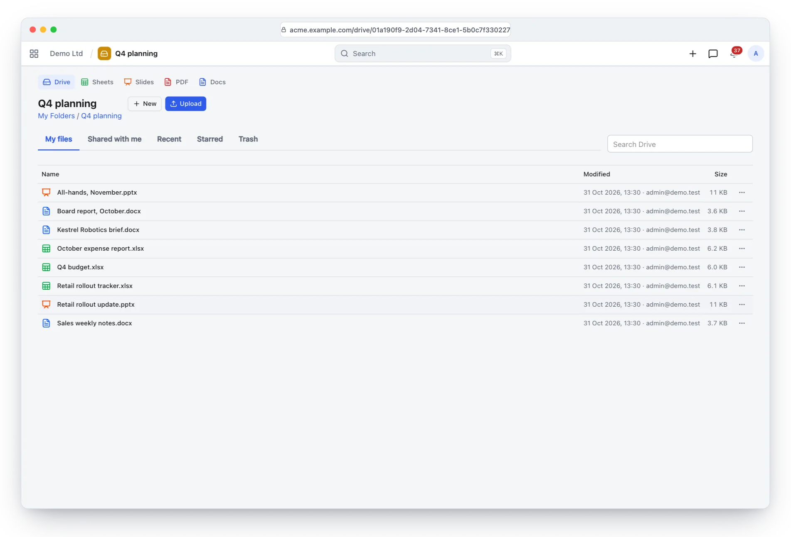
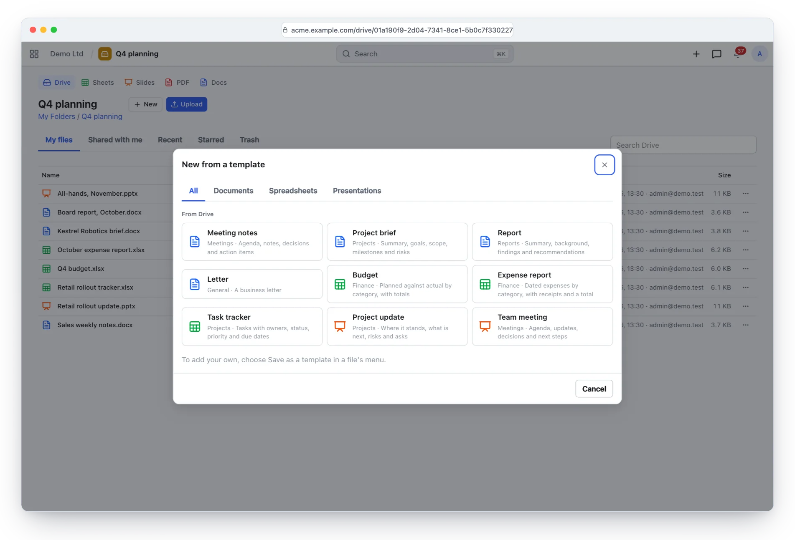
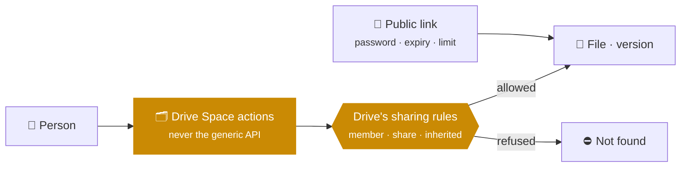
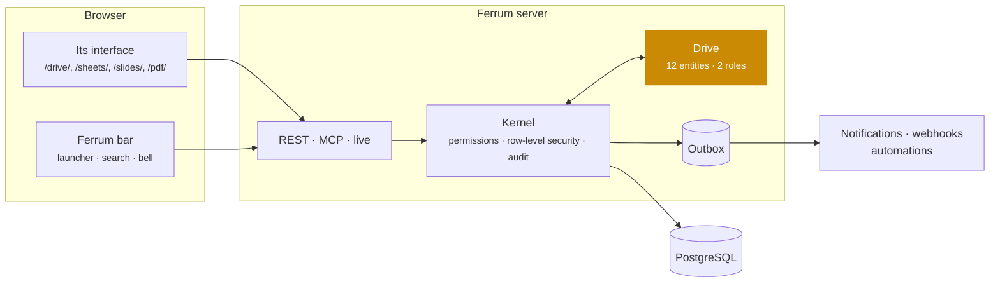
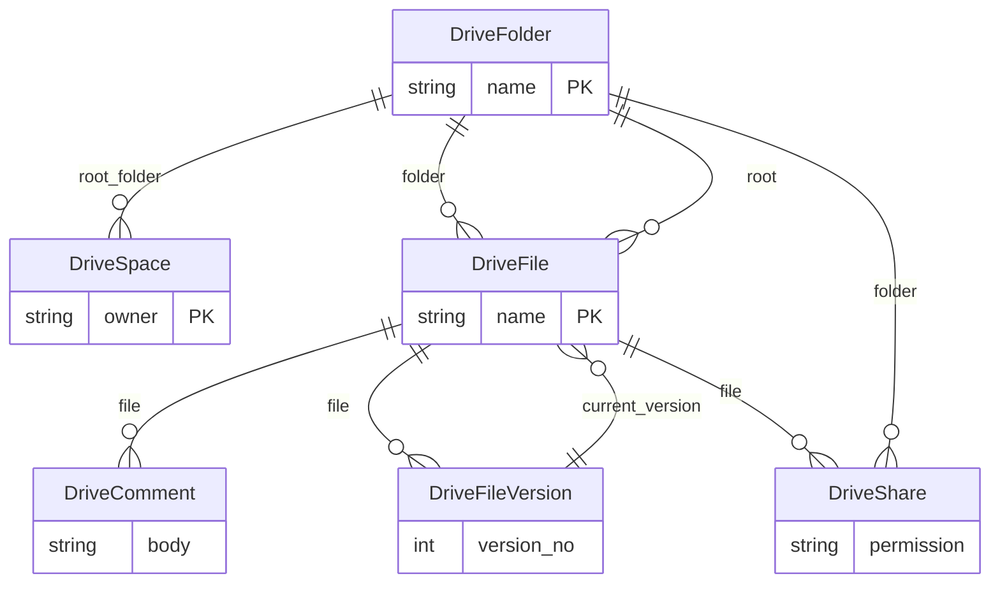

<div align="center">

<picture>
  <source media="(prefers-color-scheme: dark)" srcset="docs/assets/banner-dark.svg">
  
</picture>

[](https://github.com/CBFerrum/ferrum-app-drive/actions/workflows/ci.yml)      

**A native app for [Ferrum](https://github.com/CBFerrum/Ferrum), the open-source, AI-first business platform.**

[Overview](#overview) · [Highlights](#highlights) · [Screenshots](#screenshots) · [How it works](#how-it-works) · [Data model](#data-model) · [Install](#install) · [Develop](#develop) · [Changelog](#changelog)

</div>

---

## Overview

Ferrum Drive stores the workspace's files: personal spaces and team folders, versions with
comments, sharing with people or roles that folders pass on, expiring public links, trash and
quotas. Documents open in the browser and are edited together live; new documents, spreadsheets
and presentations start from a template gallery; and every file is reached only through Drive's
own sharing rules.


| At a glance | |
|---|---|
| 📦 Version | `0.11.0` |
| 🧱 Platform | Ferrum `>=0.3.2, <0.4` |
| 🔗 Requires | nothing else |
| 🖥️ Interface | its own, at `/drive/`, `/sheets/`, `/slides/`, `/pdf/` |
| 🗃️ Records | 12 entities in 1 package |
| 👥 Roles | 2: Drive User, Drive Administrator |
| 📊 Reports | 5 |
| 🧪 Tests | 21 Rust tests, 2 interface test files |


## Highlights

<table>
<tr>
<td width="50%" valign="top">

### 📁 Spaces and team folders
Members as Viewer, Commenter, Editor or Manager; colours, breadcrumbs, sorting and paging.

</td>
<td width="50%" valign="top">

### 🕒 Versions
History with comments, restore as a new version, check-out and check-in.

</td>
</tr>
<tr>
<td width="50%" valign="top">

### 🔗 Sharing and links
People or roles, inherited by folders, optional expiry; public links with passwords and limits.

</td>
<td width="50%" valign="top">

### ✍️ Live documents
Documents edited together in the browser, saved as people type.

</td>
</tr>
<tr>
<td width="50%" valign="top">

### 🧩 Templates
A template gallery for Word, Excel and PowerPoint files, plus your workspace's own.

</td>
<td width="50%" valign="top">

### 🛡️ Safe by design
Quotas that hold under concurrency; anything a browser could run is served as opaque bytes.

</td>
</tr>
</table>

## Screenshots

<picture>
  <source media="(prefers-color-scheme: dark)" srcset="docs/assets/drive-dark.webp">
  
</picture>

<p align="center"><sub>A folder of documents, spreadsheets and presentations, each opening in the browser.</sub></p>

<picture>
  <source media="(prefers-color-scheme: dark)" srcset="docs/assets/templates-dark.webp">
  
</picture>

<p align="center"><sub>New from a template: Drive's own Word, Excel and PowerPoint templates, and the workspace's.</sub></p>

> [!TIP]
> The screenshots follow your GitHub theme: switch between light and dark to see both.

## How it works

### Who reaches a file



### Inside Ferrum



Everything Drive adds is ordinary Ferrum metadata and Rust: its records get lists, forms,
search, permissions, an audit trail, exports and the REST and MCP APIs for free, so AI agents work
with them under the same rules as people.

### What it adds to Ferrum

| Where | What |
|---|---|
| 🚀 Launcher | **Drive** at `/drive/` |
| 🚀 Launcher | **Sheets** at `/sheets/` |
| 🚀 Launcher | **Slides** at `/slides/` |
| 🚀 Launcher | **PDF** at `/pdf/` |
| 🔀 Intent | `pick` file |
| 🔀 Intent | `preview` file |
| 🔀 Intent | `share` file |
| 🗔 Side panel | Comments and history |
| 🌐 Public page | Shared file |
| 🧩 Extension point | `drive.editor` |

## Data model

The main records and how they connect (12 entities in all; `packages/` has every field).



### Roles

| Role | What it is for | Entities |
|---|---|---|
| **Drive User** | Uses Drive: a personal space, the team folders they belong to and whatever is shared with them. Every operation is an action on their own Drive Space, checked against Drive's sharing rules; folders, files and their records stay hidden from the generic API. | 2 |
| **Drive Administrator** | Manages Drive: settings, quotas, team folders, the workspace's templates for new files, and full access to every space, folder, file, share, link, comment and activity record; runs the storage reports. | 11 |

<details>
<summary><b>Reports (5)</b></summary>

- Drive Storage By User
- Drive Storage By Team
- Drive Storage By Type
- Drive Largest Files
- Drive Shared Externally

</details>

## Install

Workspace administrators install it from **Apps** (`/store/`) in Ferrum; it ships in the
official Ferrum server image. Self-hosters building their own image enable the
`drive` feature of the server. Everything it adds is also available to AI agents over
Ferrum's MCP server, within each person's permissions.

## Develop

Clone it next to the platform:

```text
work/
├── ferrum/            https://github.com/CBFerrum/Ferrum (with Ferrum-Frontend cloned into ferrum/web)
└── ferrum-app-drive/
```

Point the platform dependencies at your checkout (this file is git-ignored):

```toml
# .cargo/config.toml
[patch."https://github.com/CBFerrum/Ferrum"]
ferrum-apps = { path = "../ferrum/crates/apps" }
ferrum-calc = { path = "../ferrum/crates/calc" }
ferrum-domain = { path = "../ferrum/crates/domain" }
ferrum-kernel = { path = "../ferrum/crates/kernel" }
ferrum-meta = { path = "../ferrum/crates/meta" }
```

The tests need PostgreSQL with an ordinary (non-superuser) role, so row-level security
applies:

```bash
createuser ferrum --pwprompt && createdb -O ferrum ferrum_drive_test
cargo test
```

`FERRUM_DRIVE_TEST_DATABASE_URL` overrides the database URL.


The interface lives in `ui/` and builds with Ferrum-Frontend's packages:

```bash
cd ui
npm run build      # ui/dist, checked against the size budget
npm test
```

With a development server started with `FERRUM_DEV_UI=1`, `ferrum-app dev --ui` serves the pages
from Vite behind the real bar and session, with hot reload.


### Project layout

```text
app.yaml      the manifest: id, version, requirements, what it adds to Ferrum
packages/     metadata: entities, roles, reports, workflows, print formats
src/          the app's logic in Rust: hooks, actions, endpoints, upkeep jobs
ui/           its own interface (React + Vite), built into ui/dist
tests/        integration tests against a real PostgreSQL
CHANGELOG.md  what changed in each version
```

## Changelog

| Version | Highlights |
|---|---|
| **0.11.0** | Templates for new documents, spreadsheets and presentations : New offers "From a template…" beside the blank files, and Sheets and Slides offer … |
| **0.10.0** | Comments on a live document's text and in threads : `add_comment` takes an `anchor` (Yjs relative positions) and a `quote` for documents edited … |
| **0.9.0** | Images in documents edited live : uploaded to the document (`POST /files/<document>/images`, Edit), shown to whoever may view it, kept and paid … |
| **0.8.1** | The list is drawn with the suite's components: each item shows what it is (a folder, a document, a spreadsheet, a presentation, a PDF, an image, a … |

Every version is in [CHANGELOG.md](CHANGELOG.md).

## License

[AGPL-3.0-only](LICENSE), like the platform. Part of [Ferrum](https://github.com/CBFerrum/Ferrum) ·
[Report an issue](https://github.com/CBFerrum/ferrum-app-drive/issues)
